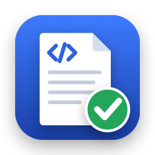

# E-Rechnung Check

A small Mac app that answers one question about an invoice file: **is this
really an e-invoice, and what does it actually say?**

Drop a PDF or XML file on the window, or right-click it in Finder and choose
**Quick Actions › E-Rechnung prüfen** ("Check e-invoice" on an English
system). The app tells you

- whether the file is an e-invoice (ZUGFeRD / Factur-X, XRechnung, Peppol) and
  in which profile, including the two ZUGFeRD profiles (MINIMUM, BASIC WL)
  that German tax rules do not accept;
- what the embedded XML says, laid out like a normal invoice;
- whether the visible PDF page and the XML disagree on invoice number, date,
  total or IBAN;
- whether mandatory fields are present, the sums add up and the IBAN checksum
  is valid.

It can also **create** e-invoices: fill in a form, and the app either embeds
the data into your existing invoice PDF (ZUGFeRD / Factur-X, profile EN 16931)
or writes an XRechnung 3.0 XML file for public bodies. See
[Creating an e-invoice](#creating-an-e-invoice).

Everything runs on the Mac. The app is sandboxed and has no network
permission, so it cannot send a file anywhere. It writes only where you save
in the Save dialog.

"E-Rechnung Check" is a working title.


## Why

On a Mac a ZUGFeRD invoice looks like any other PDF: Preview does not show
the embedded XML. Yet the XML is the part that counts legally, and software
reads the XML, not the page. This tool makes the hidden part visible.

## Creating an e-invoice

Choose **File › New e-invoice** (⌘N) or the pencil button in the toolbar.

- **ZUGFeRD PDF:** pick the PDF of your normal invoice, e.g. exported from
  Word or Pages, and fill in the form. The app saves a new PDF with the
  invoice XML (`factur-x.xml`) embedded, PDF/A-3 metadata and an sRGB output
  intent. The original file and its pages stay untouched; the data is added
  as an incremental update.
- **XRechnung (XML):** fill in the form and save the XML. Leitweg-ID, seller
  contact and both e-mail addresses are mandatory for this format.

Totals and VAT are calculated from the line items, so they always add up. The
form covers standard and reduced VAT, small businesses under § 19 UStG,
reverse charge, intra-EU supplies, exports and the zero rate, and lists
anything still missing before you can save. Your business and bank details are
remembered for the next invoice, in the app's preferences on this Mac.

After saving, the app checks the new file straight away. For a PDF, that check
also compares the visible page with the data you entered, so a typo on the
page shows up before the invoice goes out.

The page itself is not changed. Whether the result is valid PDF/A-3 also
depends on the original PDF (embedded fonts, colours, transparency), so a
PDF/A export from your word processor works best.

## Build

Requires Xcode 15 or newer on macOS 14 or newer.

```bash
Scripts/build-app.sh
```

```bash
open "build/E-Rechnung Check.app"
```

The Finder action appears once macOS has seen the app, normally after the
first launch. If it does not show up, look under Quick Actions › Customize
(or System Settings › Keyboard › Keyboard Shortcuts › Services) and switch
it on there.

The script produces an ad-hoc signed app that runs on the Mac it was built
on. A build for other people needs a Developer ID signature and notarization
(`SIGN_IDENTITY=… Scripts/build-app.sh`, then `notarytool`).

There is also a command-line tool:

```bash
swift run erechnung-check --lang de path/to/invoice.pdf
```

## Test

```bash
swift test
```

The tests use six sample invoices from the
[ZUGFeRD/corpus](https://github.com/ZUGFeRD/corpus) collection (Apache 2.0,
see `Tests/EInvoiceKitTests/Fixtures/NOTICE.md`).

## What it is not

A check for typical problems, not an official validation. It covers a subset
of the EN 16931 rules; the reference validators (KoSIT, Mustang) check far
more, including the XML schema and PDF/A conformance. It is also not tax
advice.

Sample invoices created by the app (EN 16931 and XRechnung XML, small
business, reverse charge, and ZUGFeRD PDFs) passed the
[Mustang](https://www.mustangproject.org) validator 2.26.0 without errors,
including its PDF/A-3b check. That is a spot check, not a certification:
your own invoice can still fail, for example if the original PDF is not
PDF/A-compatible.

## Layout

| Path | Content |
|---|---|
| `Sources/EInvoiceKit` | Reading and checking: PDF attachments, CII and UBL parsing, profiles, checks, PDF-versus-XML comparison. Creating: the invoice form model, the CII writer and the PDF incremental update that embeds the XML |
| `Sources/erechnung-check` | Command-line tool |
| `Sources/ERechnungCheckApp` | The SwiftUI app |
| `Resources` | `Info.plist` (document types, Finder action), the English action title and sandbox entitlements for the app bundle |
| `Scripts/build-app.sh` | Wraps the app binary into a `.app` |
| `Scripts/make-icon.swift` | Draws the app icon and writes `Resources/AppIcon.icns` |

## Support

E-Rechnung Check is free and stays free for everyone. If it saves you time,
you can support its development through
[GitHub Sponsors](https://github.com/sponsors/mjovanovski709).

**Hinweis: Unterstützung ist eine Schenkung**

Eine Unterstützung über GitHub Sponsors ist eine freiwillige Schenkung an den
Entwickler und keine Bezahlung. Mit Ihrer Unterstützung erklären Sie sich
damit einverstanden, dass

- Sie dafür keine Gegenleistung erhalten und keinen Anspruch erwerben,
  insbesondere nicht auf Support, Fehlerbehebungen, neue Funktionen, eine
  Nennung oder eine bestimmte Weiterentwicklung;
- die App für alle kostenlos bleibt, ob jemand unterstützt oder nicht;
- es keine Spende im steuerlichen Sinn ist: Der Entwickler ist keine
  gemeinnützige Organisation, stellt keine Zuwendungsbestätigung
  (Spendenquittung) aus und auch keine Rechnung. Die Zahlung ist in der Regel
  nicht steuerlich absetzbar.

Die Zahlung wird von GitHub abgewickelt; dafür gelten die Bedingungen von
GitHub Sponsors. Sie können eine laufende Unterstützung dort jederzeit beenden.

*In English:* support through GitHub Sponsors is a voluntary gift to the
developer, not a payment. By supporting the project you agree that you
receive nothing in return and acquire no claim to support, fixes, features,
a mention or any particular development; that the app stays free for
everyone; and that it is not a tax-deductible donation: no donation receipt
and no invoice are issued. GitHub processes the payment under its GitHub
Sponsors terms, and you can end recurring support there at any time.

## License

MIT, see [LICENSE](LICENSE). The sample invoices in
`Tests/EInvoiceKitTests/Fixtures` keep their own license (Apache 2.0).
