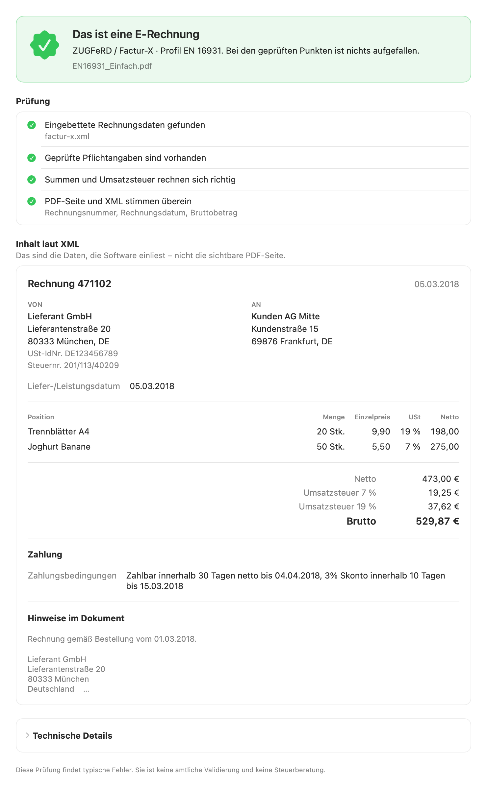

# E-Rechnung Check

A small Mac app that answers one question about an invoice file: **is this
really an e-invoice, and what does it actually say?**

Drop a PDF or XML file on the window, or right-click it in Finder and choose
**Quick Actions › E-Rechnung prüfen** ("Check e-invoice" on an English
system). The app tells you

- whether the file is an e-invoice (ZUGFeRD / Factur-X, XRechnung, Peppol) and
  in which profile, including the two ZUGFeRD profiles (MINIMUM, BASIC WL)
  that German tax rules do not accept;
- what the embedded XML says, laid out like a normal invoice;
- whether the visible PDF page and the XML disagree on invoice number, date,
  total or IBAN;
- whether mandatory fields are present, the sums add up and the IBAN checksum
  is valid.

Everything runs on the Mac. The app is sandboxed and has no network
permission, so it cannot send a file anywhere.

"E-Rechnung Check" is a working title.



## Why

On a Mac a ZUGFeRD invoice looks like any other PDF: Preview does not show
the embedded XML. Yet the XML is the part that counts legally, and software
reads the XML, not the page. This tool makes the hidden part visible.

## Build

Requires Xcode 15 or newer on macOS 14 or newer.

```bash
Scripts/build-app.sh
```

```bash
open "build/E-Rechnung Check.app"
```

The Finder action appears once macOS has seen the app, normally after the
first launch. If it does not show up, look under Quick Actions › Customize
(or System Settings › Keyboard › Keyboard Shortcuts › Services) and switch
it on there.

The script produces an ad-hoc signed app that runs on the Mac it was built
on. A build for other people needs a Developer ID signature and notarization
(`SIGN_IDENTITY=… Scripts/build-app.sh`, then `notarytool`).

There is also a command-line tool:

```bash
swift run erechnung-check --lang de path/to/invoice.pdf
```

## Test

```bash
swift test
```

The tests use six sample invoices from the
[ZUGFeRD/corpus](https://github.com/ZUGFeRD/corpus) collection (Apache 2.0,
see `Tests/EInvoiceKitTests/Fixtures/NOTICE.md`).

## What it is not

A check for typical problems, not an official validation. It covers a subset
of the EN 16931 rules; the reference validators (KoSIT, Mustang) check far
more, including the XML schema and PDF/A conformance. It is also not tax
advice.

## Layout

| Path | Content |
|---|---|
| `Sources/EInvoiceKit` | Reading and checking: PDF attachments, CII and UBL parsing, profiles, checks, PDF-versus-XML comparison |
| `Sources/erechnung-check` | Command-line tool |
| `Sources/ERechnungCheckApp` | The SwiftUI app |
| `Resources` | `Info.plist` (document types, Finder action), the English action title and sandbox entitlements for the app bundle |
| `Scripts/build-app.sh` | Wraps the app binary into a `.app` |
